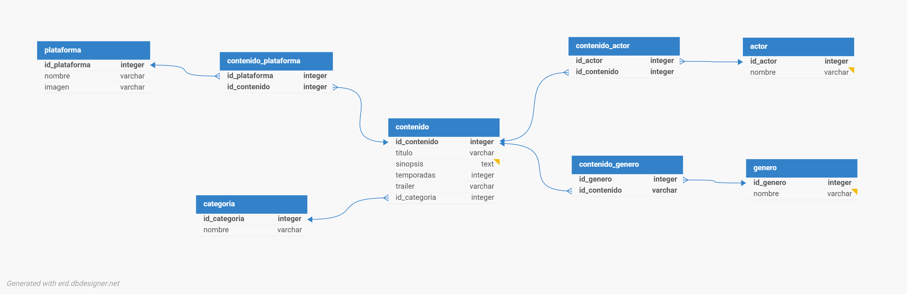

# Trailerflix — API REST con Node.js, Express, Sequelize y MySQL

## Descripción del proyecto

API REST para administrar un catálogo de películas y series, desarrollada con Node.js, Express, Sequelize y MySQL. Incluye CRUD completo, búsquedas y filtros combinados, y un catálogo web renderizado con EJS y Bootstrap.

## Consigna de la tarea

- Diseñar un modelo relacional de más de seis tablas.
- Migrar los datos de la preentrega anterior a MySQL.
- Construir una API REST con Sequelize para el CRUD de contenidos y tablas relacionadas.
- Resolver las búsquedas de la primera preentrega y los filtros combinados.
- Devolver el código de estado HTTP correcto y documentar los endpoints.

## Tecnologías utilizadas

| Tecnología | Uso en el proyecto |
| --- | --- |
| Node.js | Entorno de ejecución del servidor. |
| Express 5 | Framework HTTP y definición de rutas. |
| Sequelize 6 | ORM para modelar las tablas, relaciones y consultas. |
| MySQL 8 | Base de datos relacional `trailerflix`. |
| mysql2 | Driver de conexión entre Node.js y MySQL. |
| dotenv | Carga de configuración desde `.env`. |
| EJS | Motor de plantillas que renderiza el catálogo en el servidor. |
| Bootstrap 5 | Estilos de las páginas web; el CSS propio se sirve desde `/public`. |

## Modelo de datos

El modelo fue diseñado en DB Designer y está compuesto por ocho tablas: `contenido` como tabla central, `categoria` como relación uno a muchos, y `genero`, `actor` y `plataforma` como relaciones muchos a muchos resueltas con las tablas intermedias `contenido_genero`, `contenido_actor` y `contenido_plataforma`. Las claves foráneas de las tablas intermedias tienen `ON DELETE CASCADE`, por lo que al eliminar un contenido o una entidad relacionada se limpian automáticamente sus vínculos.



| Tabla | Descripción |
| --- | --- |
| `categoria` | Película o Serie. |
| `contenido` | Películas y series con sinopsis, temporadas, trailer y categoría. |
| `genero` | Géneros del catálogo. |
| `actor` | Actores y actrices que forman el reparto. |
| `plataforma` | Plataformas donde está disponible cada contenido. |
| `contenido_genero` | Relación muchos a muchos entre contenido y género. |
| `contenido_actor` | Relación muchos a muchos entre contenido y actor. |
| `contenido_plataforma` | Relación muchos a muchos entre contenido y plataforma. |

## Base de datos

El script `database/trailerflix.sql` crea la base `trailerflix`, las ocho tablas, las claves foráneas y carga todos los datos: 2 categorías, 14 géneros, 4 plataformas, 136 actores, 30 contenidos (16 películas y 14 series) y sus relaciones. El mismo script puede ejecutarse desde MySQL Workbench o por consola con `mysql -u root -p < database/trailerflix.sql`.

## Estructura del proyecto

```text
trailerflix-MySQL/
├── database/
│   ├── trailerflix.sql      # Script de creación y carga de la base
│   └── trailerflix.png      # Modelo relacional exportado de DB Designer
├── docs/
│   └── API.md               # Documentación de todos los endpoints
├── public/
│   └── css/styles.css       # Estilos de las vistas
├── views/
│   ├── partials/            # Header, footer y tarjeta reutilizables
│   ├── catalogo.ejs         # Listado con filtros
│   ├── detalle.ejs          # Ficha de un contenido
│   ├── formulario.ejs       # Alta y edición
│   └── error.ejs            # Páginas de error
├── src/
│   ├── app.js               # Configuración de Express
│   ├── config/database.js   # Conexión con Sequelize
│   ├── controllers/         # Lógica de cada recurso
│   ├── middlewares/         # 404 y manejo centralizado de errores
│   ├── models/              # Modelos y relaciones
│   ├── routes/              # Rutas de la API y de las vistas EJS
│   ├── services/            # Consultas y filtros de contenidos
│   └── utils/               # ApiError y validaciones
├── .env.example
├── .gitignore
├── package.json
├── README.md
└── server.js
```

## Instalación y ejecución

1. Importar la base de datos:

   ```bash
   mysql -u root -p < database/trailerflix.sql
   ```

2. Instalar las dependencias:

   ```bash
   npm install
   ```

3. Crear el archivo de configuración y completar los datos de MySQL:

   ```bash
   cp .env.example .env
   ```

4. Iniciar el servidor:

   ```bash
   npm run dev
   ```

5. Abrir `http://localhost:3000`.

El esquema se crea con el script SQL; Sequelize solo mapea las tablas existentes.

## Endpoints principales

| Método | Endpoint | Descripción |
| --- | --- | --- |
| GET | `/contenidos` | Lista contenidos con filtros combinados. |
| GET | `/contenidos/:id` | Obtiene un contenido por su id. |
| POST | `/contenidos` | Crea un contenido. |
| PUT | `/contenidos/:id` | Actualiza un contenido. |
| DELETE | `/contenidos/:id` | Elimina un contenido. |
| GET | `/catalogo` | Devuelve el catálogo en formato resumido. |
| GET | `/titulo/:title` | Busca contenidos por título. |
| GET | `/categoria/:cat` | Filtra por categoría. |
| GET | `/reparto/:act` | Filtra por actor o actriz. |
| GET | `/trailer/:id` | Devuelve el trailer de un contenido. |
| GET | `/health` | Verifica el estado del servidor y de la base. |
| GET/POST | `/categorias` | Lista o crea categorías. |
| GET/PUT/DELETE | `/categorias/:id` | Consulta, actualiza o elimina una categoría. |
| GET/POST | `/generos` | Lista o crea géneros. |
| GET/PUT/DELETE | `/generos/:id` | Consulta, actualiza o elimina un género. |
| GET/POST | `/actores` | Lista o crea actores. |
| GET/PUT/DELETE | `/actores/:id` | Consulta, actualiza o elimina un actor. |
| GET/POST | `/plataformas` | Lista o crea plataformas. |
| GET/PUT/DELETE | `/plataformas/:id` | Consulta, actualiza o elimina una plataforma. |

La tabla completa de endpoints, los parámetros de filtrado, los ejemplos de request/response y los códigos de error están en [`docs/API.md`](docs/API.md).

## Interfaz web con EJS

El catálogo se renderiza en el servidor con EJS: los controladores consultan MySQL con Sequelize y envían los datos listos a las plantillas de `views/`. Los filtros se envían por `GET` y las altas, ediciones y eliminaciones por `POST` con redirecciones y mensajes de confirmación.

| Método | Ruta | Descripción |
| --- | --- | --- |
| GET | `/` | Catálogo con filtros por título, categoría, género, plataforma, trailer y orden. |
| GET | `/contenido/:id` | Ficha del contenido con sinopsis, géneros, reparto y plataformas. |
| GET | `/contenido/nuevo` | Formulario de alta. |
| POST | `/contenido` | Guarda un contenido nuevo y redirige a su ficha. |
| GET | `/contenido/:id/editar` | Formulario de edición con los datos actuales. |
| POST | `/contenido/:id/editar` | Guarda los cambios del contenido. |
| POST | `/contenido/:id/eliminar` | Elimina el contenido y vuelve al catálogo. |

Los errores de validación vuelven a mostrar el formulario con el detalle de los campos inválidos, y las rutas HTML inexistentes responden con una página 404; la API mantiene sus respuestas JSON.

## CRUD y filtros

| Operación CRUD | Método HTTP | Método de Sequelize |
| --- | --- | --- |
| Crear | `POST` | `create` |
| Leer | `GET` | `findAll` / `findOne` |
| Actualizar | `PUT` | `update` |
| Eliminar | `DELETE` | `destroy` |

El endpoint `GET /contenidos` permite combinar búsquedas por título, categoría, género, plataforma, actor, cantidad de temporadas y disponibilidad de trailer, además de ordenar los resultados. Para que los géneros y el reparto no se recorten cuando se filtra, primero se obtienen los ids que cumplen los criterios y después se traen los contenidos completos con sus asociaciones. Las altas y ediciones se ejecutan dentro de transacciones para que un error en una relación no deje contenidos incompletos.

## Códigos de estado

| Código | Cuándo se devuelve |
| --- | --- |
| `200 OK` | Consultas, actualizaciones y eliminaciones exitosas. |
| `201 Created` | Creación exitosa de un recurso. |
| `400 Bad Request` | Datos inválidos, ids incorrectos o filtros mal formados. |
| `404 Not Found` | Recurso o ruta inexistente. |
| `409 Conflict` | Nombre duplicado o registro relacionado que no puede eliminarse. |
| `500 Internal Server Error` | Error inesperado del servidor o de la base de datos. |
| `503 Service Unavailable` | La API no puede conectarse con MySQL. |
